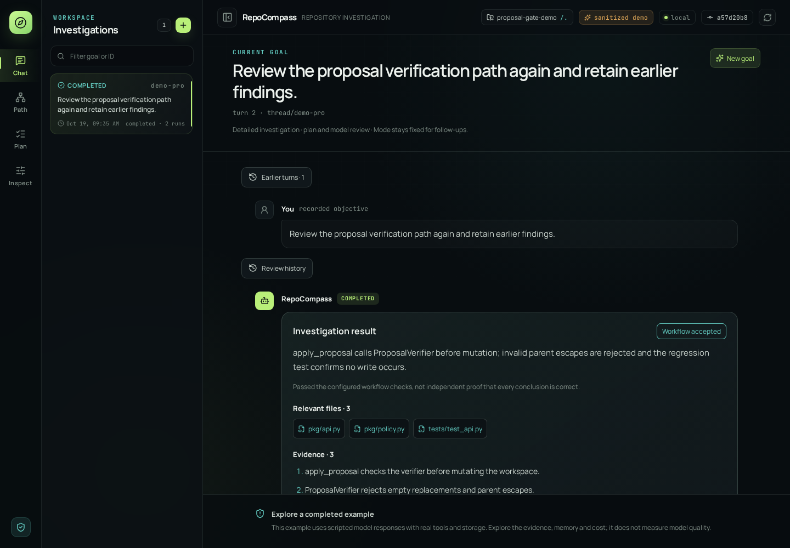

# RepoCompass

**Understand a codebase with source-backed answers, resumable investigations, and visible costs.**

[](https://github.com/xinyuz9/RepoCompass/actions/workflows/ci.yml)
[](LICENSE)

RepoCompass is a local-first repository investigation agent built with **Python, LangGraph,
FastAPI, and React/TypeScript**. Give it a repository and a question; it searches and reads
code, follows relevant relationships, and builds an answer with inspectable source references.

Understanding an unfamiliar codebase involves more than finding a matching file. You need to
connect the entry point to its dependencies, check the evidence, and retain enough context to
continue later. RepoCompass makes that investigation a persistent workflow: you can inspect
the plan, open cited source, review tool calls, recall repository memory, and examine estimated
provider costs from the same chat workspace.

[Quick start](#quick-start) · [Workflow](#how-investigations-run) ·
[Memory and recovery](#memory-checkpoints-and-recovery) ·
[Safety and costs](#tool-safety-and-cost-control) · [Architecture](#architecture)



*The included demo: scripted model responses, real workflow and storage.*

## What you can use it for

- **Codebase onboarding:** locate entry points and build a source-linked reading path.
- **Behavior investigation:** trace where a request is checked, transformed, or rejected.
- **Change preparation:** identify relevant implementation files and regression tests before editing.
- **Follow-up questions:** continue an investigation with its earlier findings and execution history.

Example goals:

> Where is checkpoint recovery implemented, and which tests cover it?
>
> Trace how proposal verification gates application.
>
> Which modules does this function depend on, and what should I read next?

The main workflow investigates a user-selected Git repository through bounded read-only tools.
Text search and source reading work across text files; symbol and relationship analysis target Python.

## Quick start

### Explore the demo in Docker

```bash
git clone https://github.com/xinyuz9/RepoCompass.git
cd RepoCompass
docker compose up --build -d
```

Open **[localhost:8767](http://127.0.0.1:8767/)**. This free, read-only demo uses scripted
model responses with real tools, workflow, and storage. It needs no key and makes no provider
calls. It demonstrates execution and the interface, not model quality.

Stop with `docker compose down`. See [Docker deployment](docs/docker.md) for read-only
repository mounts and persistent investigation data.

### Run the demo locally

Linux or WSL, Python 3.12+, [uv](https://docs.astral.sh/uv/), Git, and ripgrep:

```bash
uv sync --locked
uv run repocompass-dashboard --demo
```

Open [localhost:8766](http://127.0.0.1:8766/). The built UI is included; Node.js is
only needed when developing or rebuilding the frontend.

### Investigate your own repository

1. Copy [`.env.example`](.env.example) to the Git-ignored `.env` and configure an OpenAI or
   DeepSeek model available to your account.
2. Copy [the pricing example](examples/pricing.example.json) to a private configuration file.
   Replace its placeholder values with reviewed prices matching your provider and model.
3. Start the workspace with an absolute repository path:

```bash
uv run repocompass-dashboard \
  --repo-path /absolute/path/to/repository \
  --pricing-file /absolute/path/to/pricing.json \
  --enable-lifecycle-mutations
```

In **Chat**, declare a goal and optionally narrow it to a repository-relative focus path.
Choose the investigation mode and use **Task settings** to configure memory recall, human
review, and a per-attempt cost cap before submitting paid work. The repository root is selected
by the operator at startup; the browser cannot switch to an arbitrary filesystem path.

Omit `--enable-lifecycle-mutations` to inspect existing runs without starting new work.
[Configuration and usage](docs/getting-started.md) explains provider settings, storage paths,
CLI commands, follow-ups, and recovery. [Docker deployment](docs/docker.md) covers the
real-repository Compose configuration and persistent volumes.

## A guided tour of the demo

The demo contains a small proposal-application repository and a completed investigation.
Its application entry point calls a verifier before updating the workspace; a regression test
checks that a rejected proposal leaves the workspace unchanged.

1. Open **Chat** to read the findings and cited files: `pkg/api.py`, `pkg/policy.py`, and
   `tests/test_api.py`.
2. Open **Path** to follow the Python evidence graph and reading order. Selecting an entity
   opens a source preview with line numbers and snapshot identity.
3. Open **Plan** to see how locating the entry point, checking the policy dependency, and
   finding the regression test fit together.
4. Use **Inspect** for execution traces, selected model context, repository memory, and
   usage/cost reports. These views read persisted records; opening them does not rerun the agent.

The demo is read-only. Use your own configured workspace to submit goals, cancel attempts,
continue threads, or respond to a human-review interrupt.

## How investigations run

The model proposes what to explore and how to explain it. A deterministic controller owns
step completion, revision limits, stopping decisions, and permission to publish a result.

In a detailed investigation:

1. **Plan:** turn the goal into bounded steps with expected evidence.
2. **Explore:** use tree listing, literal search, source reads, and Python structural queries
   for the active step. Tools return bounded results through a shared gateway.
3. **Build a candidate:** assemble findings, file/line references, unresolved questions, and
   structural proposals when supported by selected AST evidence.
4. **Validate and review:** check references against source and obtain a separate model
   assessment of whether the candidate answers the active step.
5. **Decide and persist:** advance, revise, stop, or request human approval. Checkpoints,
   traces, usage, and the final result preserve what happened.

Source validation checks references and supported static relationships. A workflow-accepted
answer still needs interpretation: valid citations and a model assessment do not prove every
behavioral claim correct. Verified static edges and inferred relationships remain distinguishable
in the evidence graph.

### Quick lookup and detailed investigation

Choose the mode in the UI. Both use the same runner and safety infrastructure.

| Aspect | Quick lookup | Detailed investigation |
|---|---|---|
| Intended use | Focused file or code-location questions | Multi-step investigation and reading paths |
| Planning | A controller-seeded step | Model-proposed investigation plan |
| Repository exploration | Tree listing, text search, source reads | The same tools plus Python structural queries |
| Model review | No separate semantic evaluator | Separate semantic assessment and bounded revisions |
| Human approval | Not available | Optional before finalization |

Both retain source-reference validation, context and tool budgets, optional memory recall,
traces, checkpoints, deadlines, cancellation, and configured cost limits. Mode is fixed for a
thread; start a new goal to change it.

## Memory, checkpoints, and recovery

RepoCompass separates execution state from information that may help a later investigation:

| State | What it stores | Purpose |
|---|---|---|
| Checkpoints | Graph state, active step, thread/turn identity, pending review | Resume an unfinished investigation |
| Repository memory | Source-backed facts with repository, commit, and content provenance | Recall relevant code structure across turns |
| Episodic memory | Terminal investigation summaries, tool history, outcomes, and source fingerprints | Recall earlier investigative work |

Memory uses **SQLite FTS5/BM25** retrieval. With recall enabled, a new turn performs a bounded
search; repository scope and source-freshness checks govern the recalled facts. Retrieved
material enters the context-selection process as context, not automatically as fresh evidence.
Resuming an existing turn does not repeat its initial recall.

When a memory store is configured, terminal attempts can produce episodes. Accepted results
with structural evidence can also promote a bounded set of static Python facts after
re-indexing the current source and checking snapshot identity. Free-form model explanations
are not promoted to verified facts. Deletion records prevent automatic recreation of deleted facts.

For recovery, an unfinished thread resumes from its checkpoint; a follow-up on a completed
thread creates a new turn. Dashboard and MCP lifecycle commands use persisted request identities
to make exact retries idempotent. Refreshing the UI only reads state. Resume requires the
compatible repository snapshot; after a commit change, inspect the old result and start a new goal.

## Tool safety and cost control

The execution boundary is implemented in code, alongside the model's instructions:

- **Repository access:** tool arguments and paths are checked against the selected root.
  Source reads are bounded and reject unsafe traversal; normal investigation has no write or
  general shell tool.
- **Repeated work:** equivalent tool calls are detected, successful results can be cached for
  the snapshot, and no-progress rounds, tool calls, explorer calls, and plan revisions have limits.
- **Context:** each model invocation receives a bounded context pack. The Context inspector
  records selected items and exclusions instead of treating the entire history as an unlimited prompt.
- **Time and cancellation:** provider requests and execution attempts have deadlines.
  Cooperative cancellation is persisted; in-flight async model requests can be cancelled.
  Provider SDK retries are disabled to avoid hidden repeated requests.
- **Spending:** usage is matched to a versioned pricing snapshot. A configured per-attempt
  monetary cap controls admission of further model work; missing usage remains explicit.

Cost reports are estimates, not provider invoices. Follow-ups and resumed attempts can incur
additional charges, and cancellation cannot undo work already billed. A matching pricing file
is required for a monetary cap. For example, the CLI can investigate with a USD 0.10 attempt cap:

```bash
uv run repocompass /absolute/path/to/repository \
  --objective "Trace how proposal verification gates application" \
  --pricing-file /absolute/path/to/pricing.json \
  --max-attempt-cost-usd 0.10
```

This cap is an operator choice, not a quoted task price. See [Security](SECURITY.md) for local
data, provider disclosure, and deployment boundaries.

## Architecture

```text
React UI --> FastAPI --+
                      +--> InvestigationService --+
MCP client --> MCP ---+                            |
                                                  v
CLI ----------------------------------------> AgentRunner
                                                  |
                                      LangGraph investigation
                                      /           |          \
                               tool gateway   candidates    controller
                                    |         + evidence       |
                               repository       checks    advance/revise/stop
                                                  |
                           SQLite checkpoints, memory, traces, usage
```

FastAPI and MCP use a repository-bound service for lifecycle commands and idempotency.
The CLI calls `AgentRunner` directly. All three entry points reuse the same investigation
engine, tool policies, and persistence components. The React interface displays the backend's
persisted state and streams progress events; it does not run a second agent.

### Code map

| Component | Responsibility | Starting point |
|---|---|---|
| Python / LangGraph | Execution lifecycle and graph transitions | [Runner](src/repocompass/agent/runner.py), [graph](src/repocompass/agent/graph.py) |
| Tool gateway | Argument, path, capability, budget, and duplicate-call decisions | [Gateway](src/repocompass/tools/gateway.py) |
| Python AST analysis | Bounded symbols, imports, and source identities | [Indexer](src/repocompass/structure/python_index.py) |
| SQLite memory | Repository facts, episodes, retrieval, and deletion records | [Store](src/repocompass/memory/store.py), [retrieval](src/repocompass/memory/retrieval.py) |
| Context and cost | Model context selection and pricing-backed reports | [Context builder](src/repocompass/agent/context_builder.py), [cost](src/repocompass/agent/cost.py) |
| FastAPI / React | Backend API and interactive TypeScript workbench | [API](src/repocompass/dashboard/api.py), [UI](ui/src/App.tsx) |

[Architecture](docs/architecture.md) describes the persistent stores and module boundaries in more detail.

## Additional interfaces and extensions

- **MCP:** high-level investigation and lifecycle tools, with stdio as the default transport.
- **Static-page inspection:** an opt-in Linux/WSL Chromium + bubblewrap tool for operator-approved
  pages from one loopback origin. It does not automate arbitrary websites, logins, or browser actions.
- **Focused improvement:** a separate scoped proposal workflow with no-network sandbox
  verification, dry-run by default, and exact proposal-ID confirmation before applying changes.

The standard Docker image packages the investigation workbench; it does not include the optional
Chromium/bubblewrap runtimes. Setup and commands are in [Advanced interfaces](docs/advanced.md).

## Deployment scope

The dashboard is a **local, single-user workbench** without remote authentication; keep it on
loopback. Provider-backed investigations send selected source/context to the configured service.
Local stores and traces may contain that material, so choose the repository and provider accordingly.

Docker Compose uses a non-root process and a read-only root filesystem. The real-workspace
configuration adds read-only repository mounts and a persistent data volume.
See [Docker deployment](docs/docker.md) for configuration and limits.

## Development

```bash
uv sync --locked
uv run ruff check .
uv run ruff format --check .
uv run pytest -q
cd ui
npm ci
npm test
npm run lint
npm run build
```

Ordinary tests use local fixtures. Coverage includes lifecycle recovery, evidence validation,
memory handling, tool boundaries, cost accounting, and UI interactions. CI also builds the
distribution and exercises browser and container integration. Setup and additional test commands
are in [CONTRIBUTING.md](CONTRIBUTING.md).

Evaluation utilities under `benchmarks/` and `src/repocompass/evaluation/` support localization
and context/memory experiments. Example outputs are fixtures, not model-quality claims.
Paid provider runs require explicit opt-in; normal tests and demo startup do not use provider credentials.

## Documentation

- [Configuration and usage](docs/getting-started.md): providers, pricing, task settings, and recovery.
- [Architecture](docs/architecture.md): workflow, memory, source provenance, and persistent state.
- [Docker deployment](docs/docker.md): demo, real-repository mounts, and data volumes.
- [Advanced interfaces](docs/advanced.md): MCP, static-page inspection, and focused improvement.
- [Contributing](CONTRIBUTING.md) and [Security](SECURITY.md): development checks and operational boundaries.

## License

[MIT](LICENSE). Bundled dependencies and fonts retain their licenses; see [notices](NOTICE.md).
